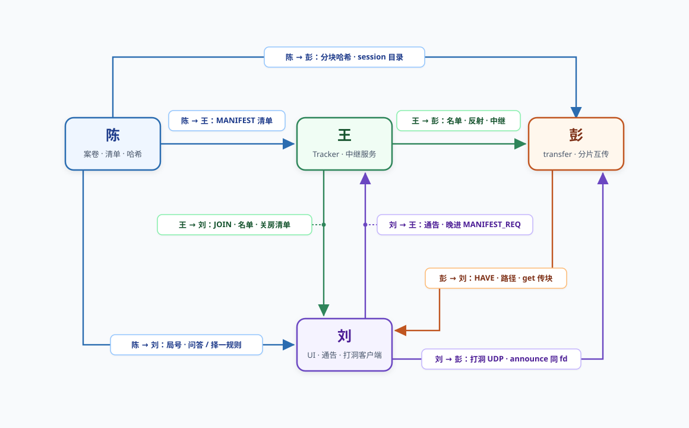

# 四人对接矩阵

基线参考：`./client`（刘通告/关房实验）、`./client_transfer`（彭传块 + 刘 UI）、`make test-transfer`。

++***下图格式：谁（交付方）→谁（接收方）：交付什么***++

---

## 1. 刘 ↔ 王

| 对齐项  | 王交付                                                | 刘消费方式                                          | 完成标准                               |
| ---- | -------------------------------------------------- | ---------------------------------------------- | ---------------------------------- |
| 进房   | `room_server`：`JOIN_OK`、`PEER_LIST`、心跳、`PROBE_ACK` | `client` / `client_transfer` 连 `PORT_ROOM_TCP` | 多端同房，成员表与名单一致                      |
| 私网地址 | 名单内私网/TCP/UDP/反射来自 `JOIN_REQ`                      | 按名单非阻塞 connect（1.5s）                           | 本网可达时路径为「本网直连」                     |
| 清单   | Tracker 缓存 `MANIFEST`，支持 `MANIFEST_REQ`            | 板上局号、三证物摘要                                     | 非「待清单」；晚进可索取                       |
| 关房   | 可停 Tracker；不再查持有                                   | 通告发现 + 晚进 TCP 要清单                              | 四窗实验 D（peer 0）验收                   |
| 对外地址 | 第 3 周：反射登记/查询接口                                    | 打洞用**同一 UDP** fd                               | 文档写明字段来源                           |
| 中继   | 正式进程 **`relay_server`**（TCP 37405）               | 失败路径连中继，界面「中继」                                 | 回落时中继字节 > 0，且不说成打洞成功；`make test-transfer` 已切 `relay_server` |
| 部署   | Tracker 与中继同机等待约定                                  | `config/room.conf`、联调 IP                       | 全组同一 `tracker_host` / `relay_host` |

**不对齐后果：** 局号空、反射 `-:0`、关房后找不到房主或传块中断。

---

## 2. 刘 ↔ 彭

| 对齐项        | 彭交付                                                   | 刘职责                                       | 完成标准                                |
| ---------- | ----------------------------------------------------- | ----------------------------------------- | ----------------------------------- |
| 统一入口       | `client_transfer`、`transfer.c`（`make transfer`）       | 收 `CMD_ANNOUNCE`、关房晚进 `tr_connect_announced` | 演示可用同一 `client_transfer` 作房主/侦探/关房 D |
| 案情板        | `ui_set_file_meta` / `ui_set_file_status`；`path_type` | 已有/缺失/来源、顶栏路径                             | `get` 后不用 `markhave` 也能「已有」         |
| HAVE 语义    | 远端 HAVE 不点亮本机                                         | UI 仅本机校验通过后标已有                            | 与 `docs/transfer_peng.md` §3 一致     |
| 打洞         | `tr_should_punch`、`tr_accept_udp`                     | 同 fd 发 `PUNCH`、认证与超时                      | 打洞成功后彭走 `PATH_PUNCH`                |
| Tracker 离线 | 保留 peer，继续 `get`                                      | 状态文案与板上事件                                 | 杀 `room_server` 后仍可 `FILE_COMPLETE` |
| 游戏命令       | `get` / `pause` / `stats`                             | `next` / `answer` / `choose` + **选项汇总记录** | 证物齐可推进阶段                            |
| 日志/事件      | `event(t, ...)` 字符串                                   | 是否映射到「最近事件」                               | 两人定一种演示习惯                           |

**已对齐：** `client_transfer` **已收** `CMD_ANNOUNCE` 并 `tr_connect_announced`。实验 7 可用 `./client` 或 `./client_transfer` 作 D 窗（peer 0、禁止 join）。

**仍待三人联测：** 跨网打洞（刘环境 + 王反射地址 + 彭 UDP）。

---

## 3. 刘 ↔ 陈

| 对齐项      | 陈交付                                     | 刘消费                                      | 完成标准               |
| -------- | --------------------------------------- | ---------------------------------------- | ------------------ |
| MANIFEST | v1 字段；`tools/gen_case.py` / `session_*` | `tr_manifest` / 板上摘要                     | 三行证物元数据可见          |
| 种子       | 不出进程、不进清单                               | 界面永不显示种子                                 | 仅 hash/大小/章别       |
| 房主       | 生成三文件并供房主上传清单                           | `--host --session` join 发 `CMD_MANIFEST` | Tracker/侦探能拿到同一份清单 |
| 问答/择一    | 答案在案卷内容中                                | `answer`/`choose` 是否校验正文                 | 书面约定：真校验或流程占位      |
| 实验 8     | 上传统计口径                                  | 刘不用 `stats` 代替陈实验                        | 分工不混用              |

---

## 4. 彭 ↔ 王

| 对齐项        | 说明                                         | 完成标准                           |
| ---------- | ------------------------------------------ | ------------------------------ |
| 反射地址       | `PROBE_ACK` / `PEER_LIST` 更新反射             | 反射非 0 后彭才应对发 UDP 载荷            |
| 中继         | `PORT_RELAY_TCP`、`RELAY_BIND`/`RELAY_WRAP` | `make test-transfer` 中继用例 PASS |
| Tracker 改动 | 粘包、peer 复用等（彭侧修复）                          | 王 review，避免双份 `room_server`    |
| 身份         | `src_id` 与 BIND 一致                         | 伪造 src 被拒绝                     |

刘不实现中继，但界面「中继」依赖本对接。

---

## 5. 彭 ↔ 陈

| 对齐项      | 说明                                   | 完成标准                    |
| -------- | ------------------------------------ | ----------------------- |
| 分块与 hash | `generate.c` 与 manifest 中 piece hash | 错块拒绝、对块校验               |
| 落盘目录     | `session_<id>/file_*`                | 重启续传路径一致                |
| 实验 8     | 房主上传 vs P2P 上传统计                     | `tr_summary` 字段含义与陈文档一致 |

---

## 6. 王 ↔ 陈

| 对齐项         | 说明                        | 完成标准                     |
| ----------- | ------------------------- | ------------------------ |
| 清单进 Tracker | 房主 `CMD_MANIFEST` 或约定 API | `MANIFEST_REQ` 拿到与同局一致清单 |
| 不存完整案卷      | 仅缓存摘要清单                   | 符合方案 §4                  |

刘晚进（通告 + TCP）也应拿到**同一份** MANIFEST。

---

## 7. 相关文档

| 文件                            | 内容                       |
| ----------------------------- | ------------------------ |
| `docs/碎片档案_项目方案.md`           | 分工与分周验收                  |
| `docs/transfer_peng.md`       | 彭交付边界与手动三端演示             |
| `docs/transfer_validation.md` | `make test-transfer` 记录  |
| `docs/wsl.md`                 | 刘侧构建、冒烟、关房四窗（`./client`） |
| `docs/generate_for_peng.md`   | 陈侧与彭对接                   |
| `docs/week1_liu.md`           | 刘模块与测试入口                 |

