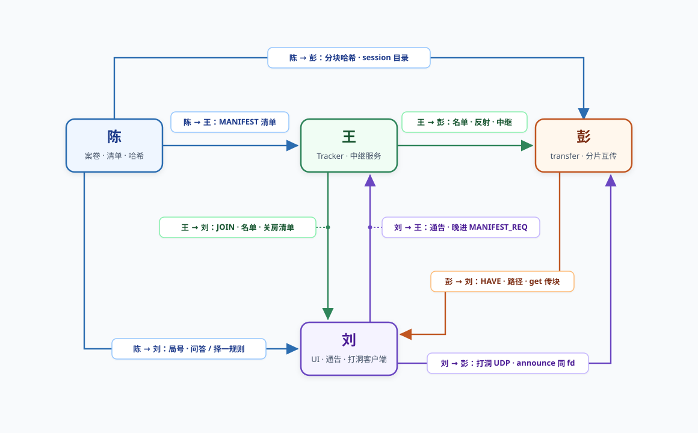

# 模块对接

**汇总：** 刘  
**验收编号：** D.04（见 [`验收总表.md`](验收总表.md)）

演示入口：`./client_transfer`。关房晚进通告允许使用 `./client`。单机回归：`make test-transfer`。

---

## 1. 刘与王

| 编号 | 验收条目 | 责任人 | 状态 |
|------|----------|--------|------|
| IV.01 | 进房：`JOIN_OK`、`PEER_LIST`、心跳、`PROBE_ACK`；多端同房成员表一致 | 王、刘 | ✓ |
| IV.02 | 名单内私网 / TCP / UDP / 反射来自 `JOIN_REQ`；本网可达时路径为「本网直连」 | 王、刘 | ✓ |
| IV.03 | Tracker 缓存 `MANIFEST`，支持 `MANIFEST_REQ`；板上局号与三证物摘要可见 | 王、刘 | ✓ |
| IV.04 | Tracker 关闭后通告发现；晚进 D 窗（peer 0）索取清单 | 王、刘 | ✓ |
| IV.05 | 反射地址供同一 UDP 文件描述符打洞 | 王、刘 | ✓ |
| IV.06 | 正式中继 `relay_server` TCP 37405；回落时路径栏为「中继」 | 王、刘 | ✓ |
| IV.07 | 全组同一 `tracker_host` / `relay_host`；服务同机 | 王 | ✓ |

---

## 2. 刘与彭

| 编号 | 验收条目 | 责任人 | 状态 |
|------|----------|--------|------|
| IP.01 | 统一入口 `client_transfer`；通告接收与 `tr_connect_announced` | 彭、刘 | ✓ |
| IP.02 | 案情板 `ui_set_file_meta` / `ui_set_file_status`；`get` 后证物为「已有」 | 彭、刘 | ✓ |
| IP.03 | 远端 HAVE 不点亮本机；本机仅在校验通过后标记已有 | 彭、刘 | ✓ |
| IP.04 | `tr_should_punch` / `tr_accept_udp`；打洞成功后走 `PATH_PUNCH` | 彭、刘 | ✓ |
| IP.05 | Tracker 离线后保留 peer，继续 `get` 至 `FILE_COMPLETE` | 彭、刘 | ✓ |
| IP.06 | 传块命令 `get` / `pause` / `stats`；游戏命令 `next` / `answer` / `choose` | 彭、刘 | ✓ |

2026-10-29 刘房主与王 Tracker 路径「打洞」、`relay_up=0`，见 [`实验记录.md`](实验记录.md) 实验 9。彭未参加该场。实验 7 的 D 窗允许使用 `./client` 或 `./client_transfer`。

---

## 3. 刘与陈

| 编号 | 验收条目 | 责任人 | 状态 |
|------|----------|--------|------|
| IC.01 | `MANIFEST` v1 字段；`tools/gen_case.py` 生成 `session_*`；板上三行证物元数据可见 | 陈、刘 | ✓ |
| IC.02 | 种子不出进程、不进清单；界面仅显示 hash、大小、章别 | 陈、刘 | ✓ |
| IC.03 | 房主 `--host --session` 发送 `CMD_MANIFEST`；Tracker 与侦探持同一份清单 | 陈、刘 | ✓ |
| IC.04 | `answer` / `choose` 与案卷正文校验规则书面约定 | 陈、刘 | |
| IC.05 | 实验 8 统计口径由陈维护；刘侧 `stats` 不替代实验 8 | 陈 | |

---

## 4. 彭与王

| 编号 | 验收条目 | 责任人 | 状态 |
|------|----------|--------|------|
| PW.01 | `PROBE_ACK` / `PEER_LIST` 更新反射后发送 UDP 载荷 | 王、彭 | ✓ |
| PW.02 | `RELAY_BIND` / `RELAY_WRAP`；`make test-transfer` 中继用例 PASS | 王、彭 | ✓ |
| PW.03 | Tracker 粘包与 peer 复用由王审阅；全组一份 `room_server` | 王、彭 | ✓ |
| PW.04 | `src_id` 与 BIND 一致；伪造来源被拒绝 | 王、彭 | ✓ |

---

## 5. 彭与陈

| 编号 | 验收条目 | 责任人 | 状态 |
|------|----------|--------|------|
| PC.01 | `generate.c` 与 manifest 分块 hash 一致；错块拒绝 | 陈、彭 | ✓ |
| PC.02 | 落盘 `session_<id>/file_*`；重启续传路径一致 | 陈、彭 | ✓ |
| PC.03 | 实验 8 字段含义与 `tr_summary` 书面一致 | 陈、彭 | |

---

## 6. 王与陈

| 编号 | 验收条目 | 责任人 | 状态 |
|------|----------|--------|------|
| WC.01 | 房主 `CMD_MANIFEST` 进入 Tracker；`MANIFEST_REQ` 返回同局清单 | 王、陈 | ✓ |
| WC.02 | Tracker 仅缓存摘要清单，不存完整案卷 | 王、陈 | ✓ |

晚进客户端经通告与 TCP 取得同一份 `MANIFEST`。
